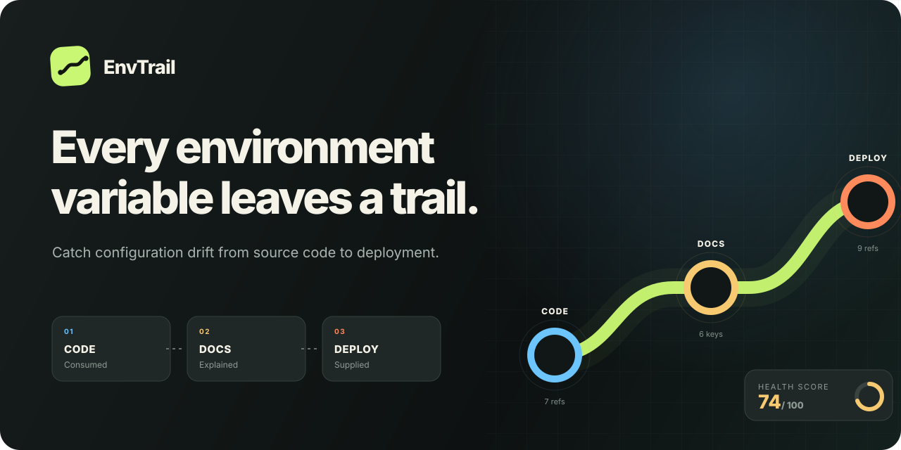
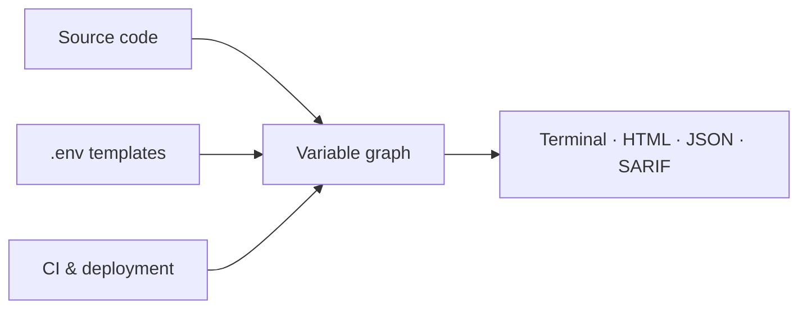
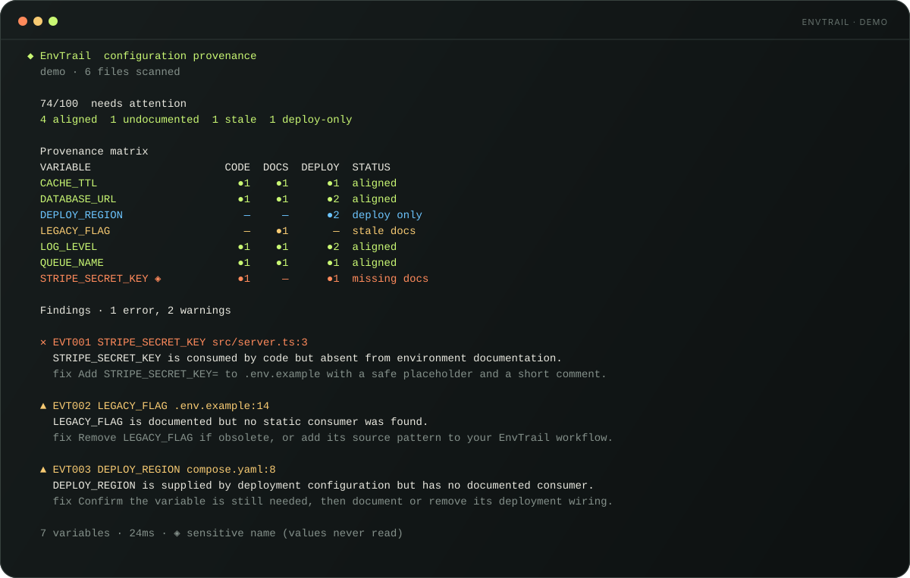
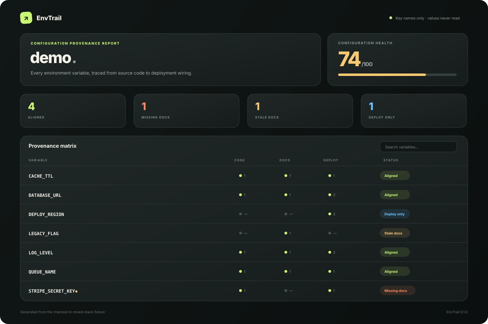

<p align="center">
  
</p>

<p align="center">
  <a href="https://www.npmjs.com/package/envtrail"></a>
  <a href="https://www.npmjs.com/package/envtrail"></a>
  <a href="LICENSE"></a>
  <a href="package.json"></a>
</p>

<p align="center">
  <strong>Trace environment variables from source code to docs and deployment.</strong><br>
  Catch configuration drift before it becomes somebody else's 2 a.m. incident.
</p>

```bash
npx envtrail check .
```

No account. No API key. No configuration required.

## Why EnvTrail?

Environment variables live in several worlds at once: application code consumes
them, `.env.example` teaches humans about them, and deployment files supply them.
Those worlds drift independently.

EnvTrail turns that scattered state into one provenance graph:



It catches:

- variables used in code but missing from developer documentation;
- stale keys that remain in `.env.example` after code is removed;
- deployment-only variables with no visible consumer;
- dynamic lookups that static analysis cannot resolve;
- duplicate template entries; and
- live `.env` files accidentally tracked by Git.

<p align="center">
  
</p>

## The report humans actually want to open

Generate a single, portable HTML file with search, drift filters, source counts,
and concrete remediation:

```bash
npx envtrail report . --output envtrail-report.html
```

<p align="center">
  
</p>

Explore the checked-in [standalone demo report](docs/demo-report.html).

The report contains key names and locations—never environment values. EnvTrail
does not open live `.env`, `.env.local`, or `.env.production` files. It only
reads explicitly safe templates such as `.env.example`.

## Supported today

| Layer | Adapters |
| --- | --- |
| Source code | JavaScript, TypeScript, Python, Go, Rust, Ruby, PHP, Java, .NET, shell |
| Developer docs | `.env.example`, `.env.sample`, `.env.template`, environment-specific templates |
| Containers | Dockerfile, Docker Compose |
| CI | GitHub Actions, GitLab CI |
| Orchestration | Kubernetes manifests |
| Automation | Terminal, JSON, Markdown, SARIF 2.1.0, standalone HTML |

See the [adapter reference](docs/adapters.md) for recognized syntax and known
limits.

## Install

Run without installing:

```bash
npx envtrail check .
```

Or add it to a project:

```bash
npm install --save-dev envtrail
```

```json
{
  "scripts": {
    "config:check": "envtrail check .",
    "config:report": "envtrail report ."
  }
}
```

Requires Node.js 22 or newer.

## CLI

```text
envtrail check [path] [options]       Analyze configuration drift
envtrail report [path] [options]      Write a standalone HTML dashboard
envtrail explain VARIABLE [path]      Show one variable's complete trail
envtrail init [path]                  Create .envtrailrc.json
```

Useful examples:

```bash
# Fail only when an error-level rule fires
envtrail check . --fail-on error

# Make warnings fail CI too
envtrail check . --fail-on warning

# Produce a code-scanning artifact
envtrail check . --format sarif --output envtrail.sarif

# Add a Markdown summary to a pull request
envtrail check . --format markdown --output envtrail.md

# Understand one variable
envtrail explain DATABASE_URL
```

## GitHub Action

After publishing this repository, replace `aryatech13` once:

```yaml
name: Configuration trail

on:
  pull_request:
  push:
    branches: [main]

permissions:
  contents: read

jobs:
  envtrail:
    runs-on: ubuntu-latest
    steps:
      - uses: actions/checkout@v7
      - uses: aryatech13/envtrail@v1
        with:
          fail-on: error
          report: envtrail-report.html
```

The Action emits file annotations and exposes `score`, `issues`, and `errors`
outputs. Its bundled `dist/action.cjs` has no install step.

## Configuration

Run `envtrail init`, then edit `.envtrailrc.json`:

```json
{
  "$schema": "https://raw.githubusercontent.com/aryatech13/envtrail/main/envtrail.schema.json",
  "exclude": ["**/generated/**"],
  "ignore": ["INTERNAL_*"],
  "rules": {
    "undocumented": "error",
    "staleDocumentation": "warning",
    "providerOnly": "warning",
    "trackedEnvFile": "error",
    "dynamicAccess": "warning",
    "duplicateDocumentation": "warning"
  }
}
```

Every rule accepts `error`, `warning`, `info`, or `off`. Read the
[rule reference](docs/rules.md) for rationale and remediation.

## Library API

```ts
import { analyze, formatJson } from "envtrail";

const result = await analyze(".");

console.log(result.summary.score);
console.log(formatJson(result));
```

The public result schema is versioned with `schemaVersion`.

## Privacy model

Configuration tooling has to earn trust. EnvTrail therefore:

- never reads files named `.env`, `.env.local`, `.env.production`, and similar;
- never stores or emits values from safe templates or deployment YAML;
- follows symlink boundaries instead of traversing them;
- skips oversized and binary files; and
- runs entirely on the local machine or CI runner.

Sensitive-looking names are marked with `◈`; their values are neither required
nor collected. See [SECURITY.md](SECURITY.md) for reporting vulnerabilities.

## Contributing

Small adapters make excellent first contributions. A new language syntax often
needs one pattern, one fixture, and one test.

Read [CONTRIBUTING.md](CONTRIBUTING.md), the
[architecture guide](docs/architecture.md), and the public
[roadmap](ROADMAP.md). Design discussions, bug reports, and documentation
improvements are welcome—not only code.

## Project status

EnvTrail is an early release. Static analysis intentionally favors transparent,
deterministic rules over guesswork. Dynamic keys and framework-specific wrappers
may require configuration or a new adapter; false-positive reports are treated
as bugs.

## License

[MIT](LICENSE) © 2026 aryatech13
