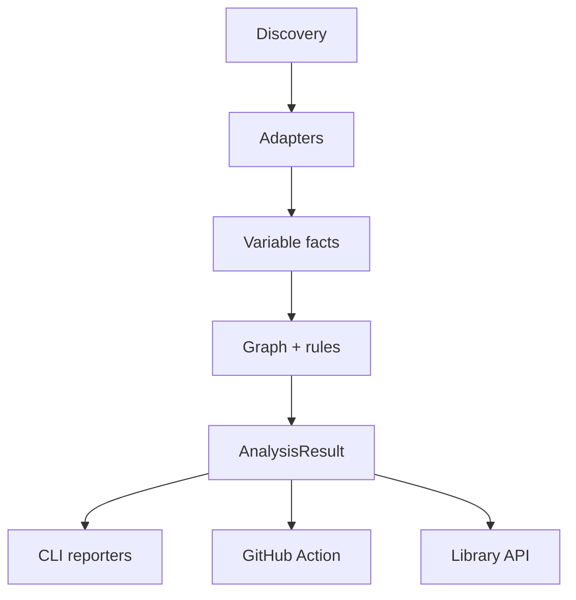

# Architecture

EnvTrail is a small pipeline with deliberately boring boundaries:

1. **Discovery** walks known source and infrastructure files, skips symlinks,
   ignores generated directories, and refuses to read live `.env` files.
2. **Adapters** emit facts. Every fact has a variable name, a role (`consumer`,
   `documentation`, or `provider`), an adapter, and a source location.
3. **Analysis** groups facts into variable nodes, assigns a status, evaluates
   rules, and calculates a health score.
4. **Reporters** render the same immutable result model as terminal text, JSON,
   Markdown, SARIF, or standalone HTML.

## Design constraints

- **No secret material in the model.** Adapters retain names and locations only.
- **No provider lock-in.** The analysis engine knows roles, not GitHub-specific
  concepts.
- **Deterministic output.** Facts, variables, and issues are sorted before
  reporting.
- **Useful partial knowledge.** A dynamic access becomes a finding rather than
  being guessed.
- **Portable automation.** The Action is bundled, while the same engine remains
  available as an npm library.

## Adding an adapter

Adapters live in `src/scanners/` and return `VariableFact` objects. A focused
contribution should include:

1. a syntax fixture that represents real code;
2. positive and negative scanner tests;
3. a short entry in `docs/adapters.md`; and
4. no captured configuration values.

If a format does not expose stable line information, use the nearest key
location and document the limitation.

## Public compatibility

`AnalysisResult.schemaVersion` covers the JSON-compatible result structure.
Adding optional fields is non-breaking. Removing or changing fields requires a
major package release or a schema-version increment.
